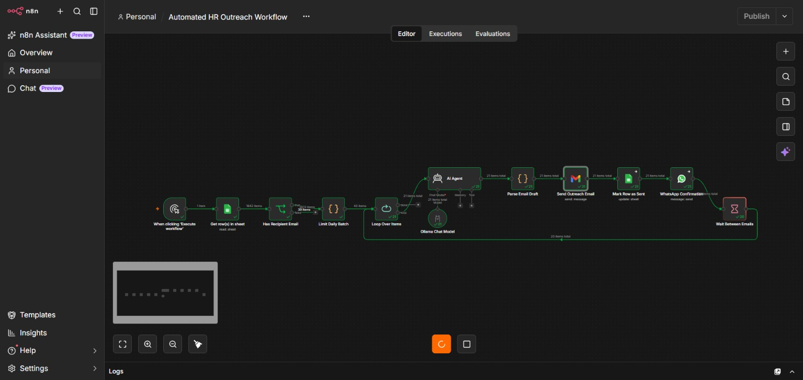
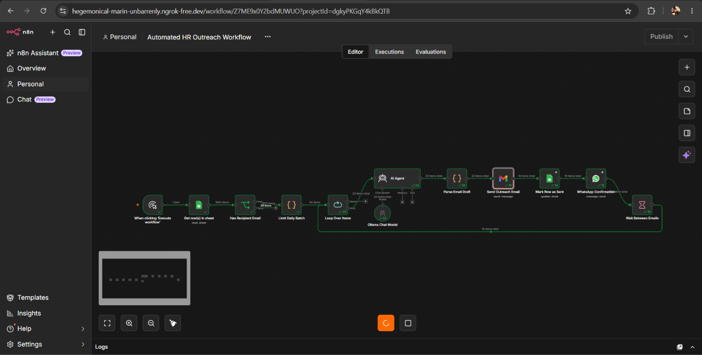
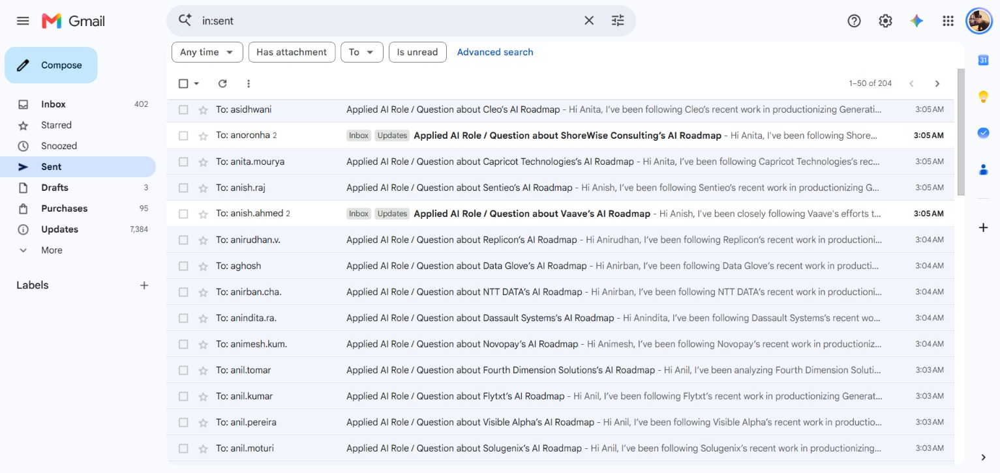
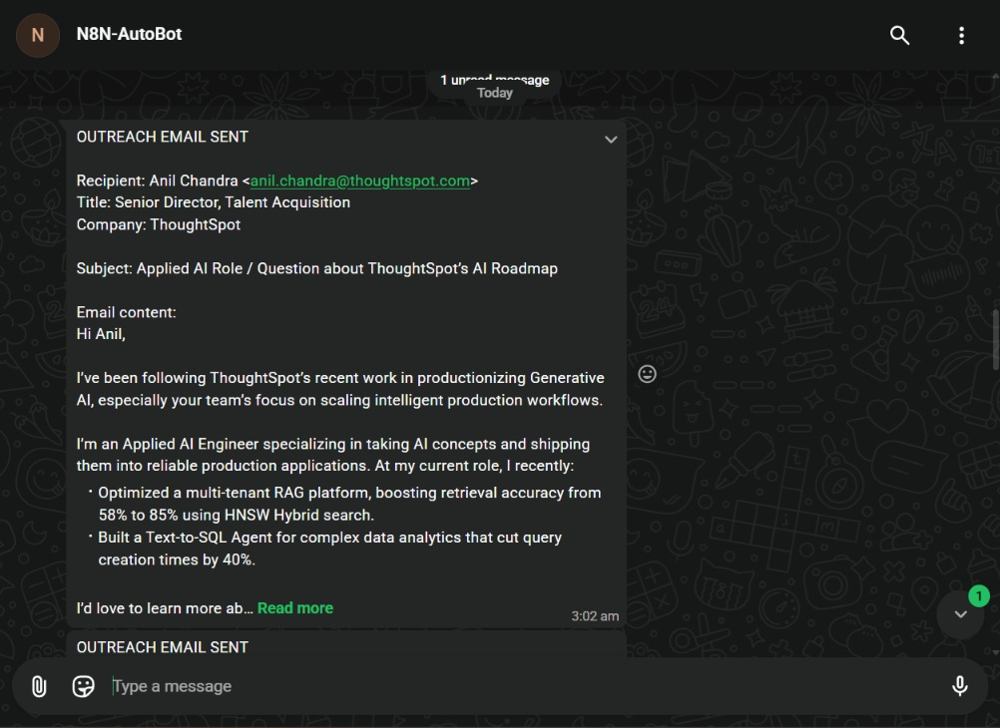
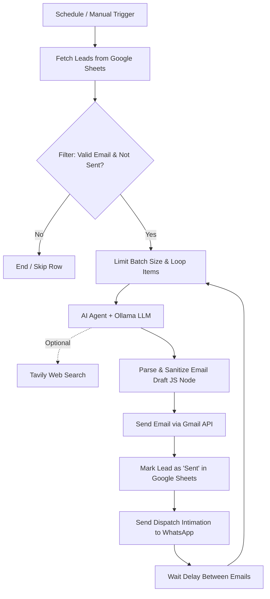

# 🚀 Autonomous AI Cold Outreach Agent (n8n + Ollama + Gmail + WhatsApp)

An intelligent, end-to-end automated cold email outreach pipeline built on **[n8n](https://n8n.io/)**. It ingests leads from Google Sheets, performs real-time company research using **Tavily**, synthesizes hyper-personalized outreach emails using local LLMs (**Ollama / LLaMA 3.2**), sends emails via **Gmail**, updates Google Sheet statuses in real-time, and sends immediate dispatch alerts to **WhatsApp**.

---

## 📸 Workflow Showcase & Visuals

### 1. Workflow Architecture & Canvas
Overview of the automated scheduling, batching, LLM agent reasoning, delivery, and notification flow:


---

### 2. Live Execution Flow
Green execution flow demonstrating automated lead extraction, AI draft generation, email sending, database row updating, and WhatsApp alerting:


---

### 3. Generated & Delivered Cold Email
Real-world output showing personalized hook, quantified achievements, and structured portfolio links delivered via Gmail:


---

### 4. Real-Time WhatsApp Dispatch Intimation
Instant notification received on WhatsApp with complete recipient information, company, subject, and message preview:


---

## 📂 Included Workflows

This repository provides two workflow configurations tailored for different outreach strategies:

| Workflow File | Trigger Mode | Key Highlights |
| :--- | :--- | :--- |
| **[`mail_outreach.json`](./mail_outreach.json)** | **Manual Execution** | • Real-time web intelligence via **Tavily Search Tool**<br>• Full AI agent reasoning with local Ollama (`llama3.2:1b`)<br>• One-click execution for targeted, high-touch outreach<br>• Instant WhatsApp dispatch report |
| **[`Schedulable_mail_outreach.json`](./Schedulable_mail_outreach.json)** | **Cron / Scheduled Trigger** | • Automated daily recurring schedule (e.g. 10:00 AM)<br>• **Batch rate limiter** to protect Gmail domain reputation<br>• Sequential looping over leads with **sleep delay throttling**<br>• **Google Sheets auto-update** (marks row as `Sent` to prevent duplicate emails)<br>• Instant WhatsApp confirmation for each email |

---

## 🛠️ Tech Stack & Integrations

- **Orchestration**: [n8n](https://n8n.io/) (Workflow Automation)
- **AI / LLM Engine**: [Ollama](https://ollama.com/) running `llama3.2:1b` (Zero API cost, 100% private & local)
- **Web Research**: [Tavily AI Search API](https://tavily.com/)
- **Lead Database**: [Google Sheets API](https://developers.google.com/sheets/api)
- **Email Delivery**: [Gmail OAuth2](https://developers.google.com/gmail/api)
- **Instant Alerts**: [Meta WhatsApp Cloud API](https://developers.facebook.com/docs/whatsapp/cloud-api)

---

## ⚙️ Architecture & Logic Flow



---

## 🚀 Getting Started

### 1. Prerequisites
- **n8n** installed and running ([Docker](https://docs.n8n.io/hosting/) or npm)
- **Ollama** running locally or on a remote server with `llama3.2:1b`:
  ```bash
  ollama run llama3.2:1b
  ```
- **Google Cloud Console Credentials** with Gmail API and Google Sheets API enabled
- **Meta WhatsApp Cloud API Account** (Access Token & Phone Number ID)
- *(Optional)* **Tavily API Key** for live web searches

---

### 2. Import Workflows into n8n

1. Open your n8n web dashboard.
2. Click **Add workflow** > **Import from File...**
3. Select either:
   - `Schedulable_mail_outreach.json` for autonomous daily batch processing.
   - `mail_outreach.json` for interactive, research-assisted outreach.
4. Configure credentials for your connected services:
   - **Google Sheets account**
   - **Gmail account**
   - **Ollama account** (Default base URL: `http://localhost:11434` or host Docker IP)
   - **WhatsApp account**
   - **Tavily account** (if using `mail_outreach.json`)

---

### 3. Google Sheet Schema

Ensure your Google Sheet contains the following column headers (first row):

| Name | Email | Company | Title | Status | row_number |
| :--- | :--- | :--- | :--- | :--- | :--- |
| Alex Mercer | alex@example.com | Acme Corp | VP of Engineering | | 2 |
| Sarah Connor | sarah@skynet.ai | Cyberdyne Systems | Head of AI | | 3 |

> **Note:** The `Status` column is dynamically updated to `Sent` upon successful email dispatch by the schedulable workflow.

---

### 4. Customizing Email Templates & Personas

Inside the **`Parse Email Draft`** JavaScript node, you can customize:
- Your name, title, and contact details
- Portfolio, LinkedIn, GitHub, and Resume URLs
- Body length, tone, and specific value proposition bullet points
- Batch size limit (`DAILY_LIMIT = 50` or `100`)
- Delay between emails (`Wait Between Emails` node)

---

## 🔒 Security & Best Practices

- **Zero API leakage**: Credentials and secrets are managed natively through n8n's secure credential vault.
- **Deliverability Protection**: Configured with built-in batch sizing and throttling delays to comply with Gmail sending limits and prevent spam triggers.
- **Idempotency**: Rows already marked `Sent` are filtered out, preventing duplicate messages to the same lead.

---

## 👤 Author

- **Tusha Rahul Bellamkonda**
- **GitHub**: [@Rahul6158](https://github.com/Rahul6158)
- **LinkedIn**: [tusha-rahul](https://linkedin.com/in/tusha-rahul)
- **Portfolio**: [tusharahul.netlify.app](https://tusharahul.netlify.app)
